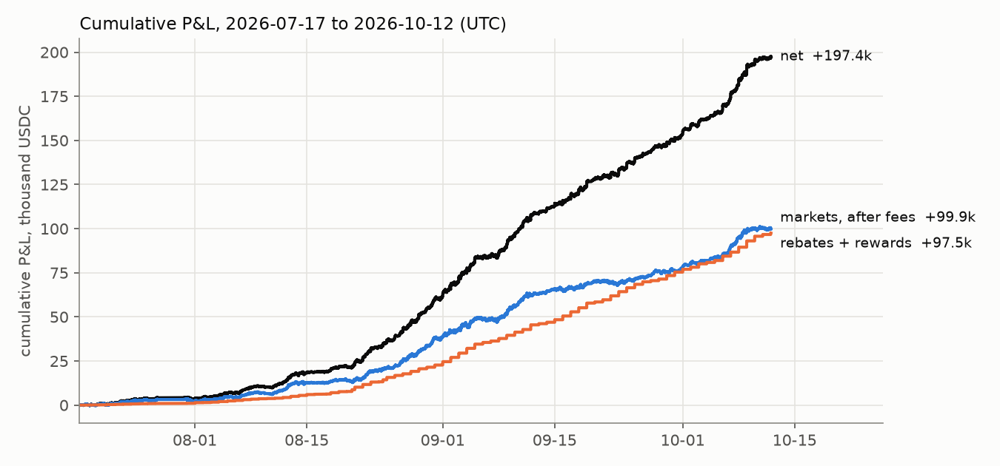
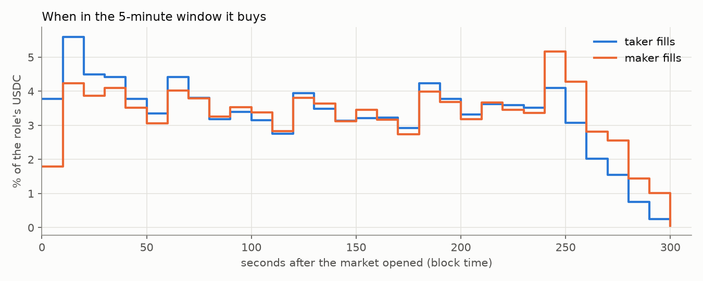
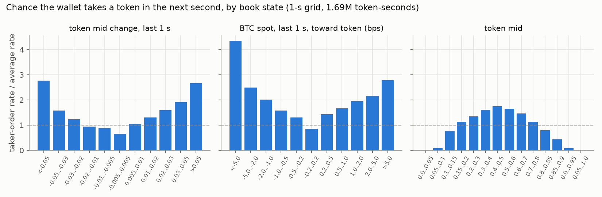
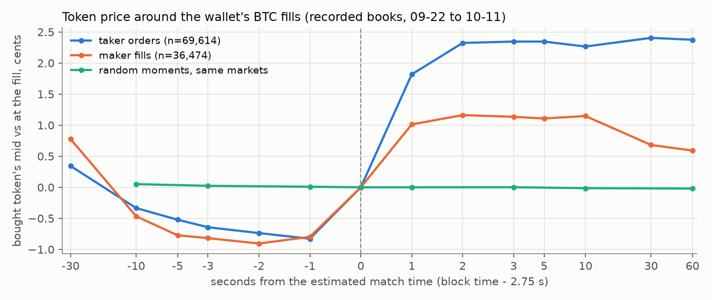
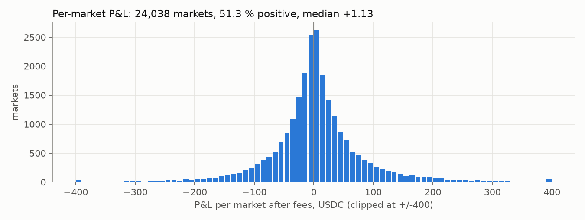
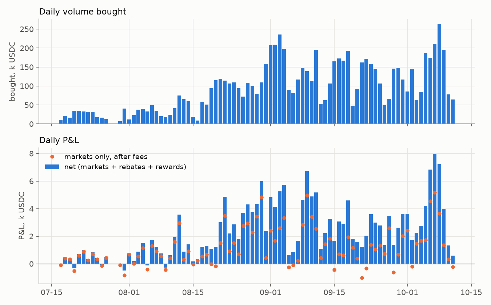
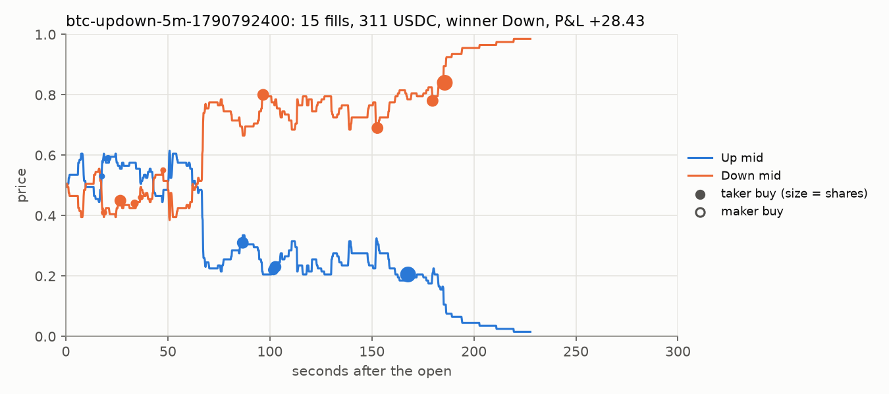
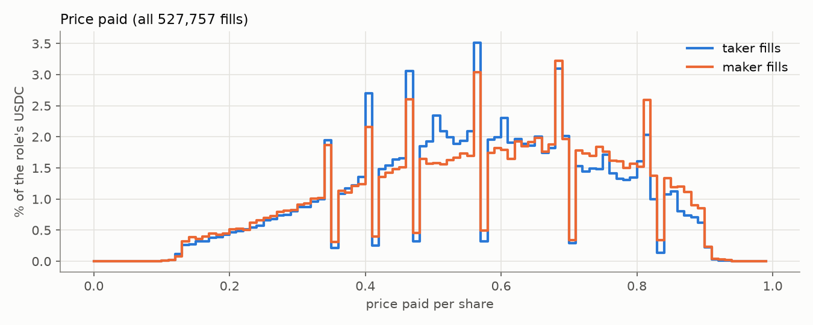

# Trader reverse-engineering: dangerously-skip-permissions (2026-10-12)

Polymarket profile `https://polymarket.com/@dangerously-skip-permissions`, proxy wallet
`0xc53375ff94e96100f2b30a4b5775db35218d69a9` (pseudonym Lone-Easel-Election, account created 2026-07-16 19:16 UTC,
taker tier 6 "Obsidian"). This report covers the wallet's **entire accessible history**, from its first fill on
2026-07-17 14:16 UTC to the cutoff on 2026-10-12 00:55 UTC. It replaces the 30-day study of 2026-10-09
(`docs/trader_dangerously-skip-permissions_2026-10-09.md`); that report's figures reproduce exactly for its own window
(see §9).

Every number has one of three labels:

- **A. Actual results**: computed from the wallet's real fills, fees, redemptions and rebates.
- **B. Reconstructed strategy**: rules inferred from the observed behaviour.
- **C. Our own tests**: checks we ran on this repo's recorded order books. None of them is the trader's result.
  No P&L backtest or replay of the inferred rules was run.

Times are UTC. Prices are per share, and a winning share pays 1 USDC (pUSD).

---

## 1. Executive summary

**Who.** An automated BTC 5-minute Up/Down trader. It also traded ETH 5-minute markets for 15 days (08-26 → 09-10).
It never traded anything else. In 88 days it bought **7.98M USDC** of outcome tokens in **527,757 fills** across
**24,038 markets**. It **never sold, merged or split**: every position was held to settlement, and winners were
redeemed about 73 s after the close.

**How it trades (A, observed).** From about 6–20 s after a market opens until about 30 s before it closes, it fires
buy orders of fixed share sizes (50, 60, 5, 30, 100, 10 … shares) into the book. It buys both tokens in 85 % of
markets, and almost only at prices between 0.10 and 0.90 (99.96 % of fills). 57 % of fills (76 % of the dollars) are
taker orders. They pay the crypto taker fee of 0.07 × p × (1 − p) per share, which the chain confirms to the cent.
The rest are maker fills of small resting bids. The median market gets 14 fills and 194 USDC; the largest got
3,845 USDC.

**What triggers a buy (B, inferred from recorded books).** Buys cluster in **fast repricing bursts**. A taker order
is 2–3× more likely in the second after the token mid moves ≥ 3–5c (up *or* down), 2–4× after a BTC move of ≥ 2 bp,
and 2.5–4× when the spread has widened to ≥ 2c. Buys favour mid prices of 0.3–0.7. The bought token has usually
been rising (47 % rose ≥ 1c in the prior 3 s, against 30 % at random moments). More importantly, **it keeps rising
after the fill: +1.8c within ~1 s and +2.4c at 60 s, with no reversal**. The wallet anticipates the next reprice. It
is not simply chasing the last one. No simple rule we could build from our 1-s book and spot recordings reproduces
its entries (best AUC 0.69), so the exact trigger stays unidentified.

**What it earned (A).**

| | USDC |
|---|---:|
| bought (incl. fees) | 7,980,273 |
| taker fees paid (on-chain) | 181,984 |
| market P&L after fees (settled) | **+99,923** (+1.25 % of bought) |
| taker rebates + maker rebates + rewards | **+97,499** |
| **net P&L** | **+197,422** |
| unrealised P&L (open positions) | 0 (every market resolved; 609 USDC of winners still unredeemed) |

78 of 85 full days were positive net. Only 67 were positive on markets alone, so the rebates (49 % of net profit)
carry the bad days. The worst peak-to-trough drawdown was −2.6k. The wallet started from a **4,000 USDC** deposit,
never had more than ~3.9k at risk at once, and has withdrawn **173.8k** in weekly sweeps, almost all on Fridays (§5.6).

**Polymarket's profile chart shows +282.0k.** That figure is the settlement P&L **before** taker fees (our +281.9k
matches it, correlation 0.999995), and it leaves out rebates. The all-time leaderboard's +98.7k is the P&L **after**
fees, again without rebates. Neither number is the net result.



---

## 2. Data coverage

| source | what | records | range / notes |
|---|---|---:|---|
| data-api `/activity` | every TRADE, REDEEM, rebate and reward record | 550,256 | 2026-07-17 14:16:18 → 2026-10-12 00:52:30. 8,452 fifteen-minute windows; the largest held 423 records, so none hit the 500 cap and nothing was paged or lost |
| ↳ TRADE (all BUY) | fills | 527,755 | 0 SELL, 0 MERGE, 0 SPLIT, 0 CONVERSION |
| ↳ REDEEM | redemptions | 22,304 | 8,079,587.45 USDC |
| ↳ TAKER_REBATE / MAKER_REBATE / REWARD | daily payments | 86 / 85 / 26 | 85,134.59 / 11,320.41 / 1,044.34 USDC |
| Polygon logs (exchange `0xe1111800…`) | `OrderFilled` events of orders signed by the wallet | 527,809 | 527,755 match the API 1 : 1 on (tx, token, shares). 2 are missing from the API (09-22 09:35 market, 13.8 shares) and were added. 52 fall after the cutoff and were dropped |
| Polygon archive `eth_call` | pUSD balance at the last fill before each UTC midnight | 88 | closes the cash identity to the cent (§5.6). On 10-12 01:35, USDC.e and native USDC balances were 0 |
| Polygon logs (pUSD) | transfers on the 12 days with an external flow | see §5.6 | the deposit / withdrawal transactions |
| gamma `markets?closed=true` | outcome, token ids, fee schedule | 24,038 / 24,038 | all resolved (`umaResolutionStatus = resolved`, prices 1/0): 11,988 Up, 12,050 Down. Fee schedule on every market: `crypto_fees_v2`, rate 0.07, exponent 1, taker-only |
| data-api `/positions` | currently held tokens | 1,748 | 1,721 at price 0 (losers, nothing to redeem), 26 at ~1 (unredeemed winners, value 608.81) |
| data-api `/closed-positions` | — | 8,150 | rate-limited (HTTP 429) before the end; **not used** for any figure |
| profile, leaderboard, `user-pnl` series | the trader's displayed P&L and volume | — | compared in §5.7 |
| this repo's recorded books (`data/charts`) | 200-ms BTC 5m books + composite BTC spot | 3,669 markets, 106,088 fills | 09-22 → 10-11, **20 % of all fills**; used only in §3 and §6 |

**Not available:** order submission times, cancelled or unfilled orders, the wallet's order types (FAK/GTC), and
sub-second match times. Block timestamps are whole seconds, and the match happens ~2–3 s before the block (§9).
Deposits and withdrawals come from on-chain balances (§5.6).

---

## 3. Reconstructed strategy

### 3.1 Market selection

| | evidence | label |
|---|---|---|
| Only BTC 5-minute Up/Down markets, plus ETH 5-minute from 2026-08-26 19:40 to 2026-09-10 03:10 (2,918 markets, 1.9 % of dollars) | activity slugs | A, observed |
| Trades a median **92 %** of the 288 daily BTC slots (p25 82 %, p5 55 %) | markets per day | A |
| Of 3,776 untraded BTC slots between its first and last market, 2,406 fall in 69 pauses of 30 min or more (20 longer than 2 h; the longest is 07-27 09:20 → 07-30 15:40), 562 in runs of 2–5 and 808 are single skipped markets | slot gaps | A |
| Single skipped markets are **quiet ones**: in the 55 such markets we recorded, the Up mid made 7 moves ≥ 2c (39 in traded markets) and spent 24 % of the time inside 0.10–0.90 (60 %) | recorded books | B, strongly supported: a skip is a by-product of the trigger and the price band, not a separate filter |
| Trades around the clock. Dollar volume per hour is highest 13–19 UTC (4.7–5.8 % per hour vs 3.3–4.4 % in other hours); markets per hour are flat | hour of day | A |

### 3.2 Entry rules

**Observed (A):**

- **Price band.** 99.96 % of fills are priced 0.10–0.90. Fills above 0.90 are 0.066 % of dollars and fills below
  0.10 are 0.004 %. Prices are centred on 0.30–0.65 (taker median 0.49, maker median 0.44).
- **Timing.** The first fill comes a median 19 s after the open (p10 6 s, p90 121 s). Fills then spread evenly over
  the window (10–14 % of dollars per 30 s) until the last minute, where the taker share falls from 56–64 % to 40–46 %. There
  are no buys before the open. 258 fills (0.05 %) have a block time at or after the close; they lost 14.6 %. Volume
  steps up at the 60, 120, 180 and 240 s marks (chart below).
- **Order flow.** A market sees a median of 14 orders, a median of 2 s apart (p90 17 s). 15 % of taker fills come in
  same-second clusters of 2–6 orders on the same token, often at different prices (for example 0.18, 0.24 and 0.20 in
  one second, §6.2).



**Inferred from recorded books (B).** These results come from our 1-s grid of 1.69M token-seconds over 3,669
recorded markets. They are our measurements of the trader's behaviour, not its results.

| book state in the last second | taker-order rate vs average |
|---|---:|
| token mid fell ≥ 5c / rose ≥ 5c | **2.8× / 2.7×** |
| token mid flat (±0.5c) | 0.65× |
| BTC spot moved ≥ 5 bp against / toward the token | 4.4× / 2.8× |
| spot flat (±0.2 bp) | 0.86× |
| spread 1c / 2c / 3–5c / > 5c | 0.96× / 2.5× / 3.3× / 4.2× |
| token mid 0.4–0.5 / 0.1–0.15 / 0.85–0.9 / < 0.1 or > 0.9 | 1.75× / 0.76× / 0.43× / ≤ 0.09× |
| 2–3 s after its own previous taker order / > 30 s after | 2.9× / 0.21× |



- **Trigger = a burst of repricing, not a direction.** The rate rises for large moves in *either* direction of both
  the token and spot. The same burst makes one token rise and the other fall, and the wallet often buys both.
- **The size of a move matters, not its sign.** Taken alone, signed token and spot moves predict nothing
  (AUC 0.49–0.52). Their absolute sizes do (|token move| 1 s / 3 s: AUC 0.60 / 0.62; |spot move| 1 s / 3 s: 0.58 /
  0.60).
- **Near the middle of the price range.** Distance of the mid from 0.5 is the strongest single feature (AUC 0.63).
  In the joint model, the weights are: distance from 0.5 (z −119), time in window (z +63), |spot 3 s| (z +26), |token
  move| (z +17–19) and spread (z +7).
- **Not a spot-vs-strike fair-value rule (C, our test).** We priced each token with a standard model,
  P(Up) = Φ(ln(S/K) / (σ√t)), using our composite spot, the recorded strike and each market's own 1-s volatility.
  The model is well calibrated: when it says 0.4–0.5, Up wins 44 % of the time. At the wallet's entries, the model's
  edge over the ask is the same as at random moments (median −0.8c vs −0.5c; 44 % positive vs 47 %), and the entry
  rate barely changes with the edge (0.81–1.17×).
- **Not reproducible from our features (C).** A logistic model on signed and absolute token and spot moves
  (1/3/10 s), ask change, distance from 0.5, spread and time in window reaches only AUC 0.69. The rule "token rose ≥ 1c in the last second, mid
  0.10–0.90" catches 26 % of the wallet's entries, and only 7 % of its firings are followed by a wallet entry.

### 3.3 Direction selection

| at the wallet's taker orders | wallet | random moments |
|---|---:|---:|
| bought token rose ≥ 1c in the prior 3 s | **47.2 %** | 30.2 % |
| bought token fell ≥ 1c in the prior 3 s | 32.1 % | 30.9 % |
| BTC moved > 0.5 bp toward / against the bought side, prior 3 s | 22.9 % / 18.9 % | — |
| bought token's mid 1 s / 3 s / 60 s after the fill | **+1.82c / +2.35c / +2.37c** | +0.00 / +0.00 / −0.02c |
| BTC toward the bought side 1 s / 3 s after | +0.20 / +0.31 bp | ~0 |



- **Observed (A).** Up and Down get equal shares of the money (49.3 % / 50.7 %). The wallet buys the favourite
  (price > 0.5) in 47.5 % of taker fills and 40.0 % of maker fills. The bigger side of a market wins only 50.4 % of
  the time, so there is no market-level directional skill.
- **Inferred (B).** It buys the token that is about to rise. Most often (47 %) that token is already rising
  (momentum). In 32 % of cases it has just fallen, and then it rebounds. The bought token rises after the fill
  whatever happened before it: +1.6c in 1 s after a ≥ 1c fall over the prior 3 s, +2.3c after a flat 3 s, +1.8c
  after a ≥ 1c rise. The move lasts at least 60 s. In our recording, spot moves toward the bought side mostly
  **after** the fill. Two readings fit: the wallet reads a faster price feed than ours (exchange or Chainlink ticks),
  or it reads Polymarket order-flow signals we do not record. With whole-second block times we cannot tell them apart
  (§8).

### 3.4 Exit rules

**Observed (A).** There are no sells, merges or splits in 550,256 records or on-chain. Every position is held to
resolution. Winners are redeemed a median 73 s after the close (p10 46 s, p90 106 s, p99 8 min). 44 winning
positions worth 608.93 are still unredeemed. Losing tokens are left in the wallet: 1,721 positions at price 0.

### 3.5 Position sizing

| | taker fills | maker fills |
|---|---:|---:|
| shares per fill, median (p10 / p90 / p99) | 33 (5 / 86 / 150) | 7.5 (1.7 / 49 / 106) |
| USDC per fill, median (p90) | 15.2 (43.9) | 3.3 (21.9) |
| most common sizes (fills) | 50 (45.6k), 60 (25.0k), 5 (24.9k), 30 (19.1k), 100 (15.9k), 10 (13.0k), 25, 20, 15, 80, 90, 75 | 5 (19.6k), 10 (7.4k), 50, 20, 60, 30, 6, 15, 80 |
| integer share count | 77 % | 31 % |

- **Observed (A).** Orders come from a **menu of fixed share sizes**, not fixed dollar amounts. Non-integer fills are
  partial fills against a resting order's remaining size. The menu changes week by week: 30/90/5 in mid-July,
  80/50/20 in mid-August, then mostly 50/100/5 and 60/5/100 in October.
- **Per market (A).** Median 194 USDC (p90 829, p99 1,847, max 3,845). The monthly median rose from 86 (July) to 145
  (Aug), 274 (Sep) and 386 (Oct, to the 12th), in step with the wallet's profits.
- **No loss-chasing (A).** After a losing market, the next market's cost is 1.000× the trailing 48-market median
  (0.998× after a win, 1.06× after a worst-5 % loss). The correlation between one market's P&L and the next market's
  cost is 0.013. The day after a losing day has the same volume (1.02×). There is no martingale or recovery sizing.

### 3.6 Repeated entries, pyramiding, averaging down

**Observed (A).** A market sees a median 14 orders (p90 54, p99 106). 36 % of consecutive orders switch token. When
a taker order adds to the same token, it pays a higher price than the previous order in 50 % of cases and a lower
price in 39 %. The wallet adds as a token moves either way. The token it buys first ends up as the bigger position
in 64 % of markets. The token of its **last** order wins 55.1 % of the time; the token of its first order wins
51.3 %.

**Inferred (B).** Neither pyramiding nor averaging down is a rule. Each order is a separate reaction to a reprice,
and the later orders, made with more information, are slightly better.

### 3.7 Hedging and paired positions

| (A) | |
|---|---|
| markets with both tokens bought | **85.3 %** |
| average Up price + average Down price (pair cost), median (p10 / p90) | 0.997 (0.855 / 1.114); below 1 in 44.0 % |
| matched shares as a share of the bigger side, median | 61 % |
| delay from first fill to the first fill on the other token, median (p10 / p90) | 15 s (2 s / 93 s) |
| P&L of the matched part (min(Up, Down) shares × (1 − pair cost)) | +21,448 |
| P&L of the unmatched lean | +78,475 |

| size of lean (unmatched / bigger side) | markets | bigger side won | P&L |
|---|---:|---:|---:|
| ≤ 10 % | 3,400 | 48.0 % | +493 |
| 10–25 % | 4,790 | 51.1 % | +15,049 |
| 25–50 % | 6,555 | 51.6 % | +64,445 |
| > 50 % (includes one-sided) | 9,293 | 49.0 % | +19,936 |

**Inferred (B), strongly supported.** The two-sided book is a **by-product** of buying whichever token is about to
reprice. It is not a deliberate pair lock. The opposite token is bought when the market swings back (15 s median
delay). The pair cost straddles 1 (median 0.997), so the hedge alone earns little. The lean makes the money through
good entry prices, not through picking the winner (the bigger side wins 50.4 %).

### 3.8 Order execution

| (A, on-chain) | taker | maker |
|---|---:|---:|
| fills | 298,678 (56.6 %) | 229,079 (43.4 %) |
| USDC | 6,101,469 (76.5 %) | 1,878,805 (23.5 %) |
| fees | 181,984.07 (3.07 % of taker notional) | 0 |

- **Fee check (A).** Every taker `OrderFilled` event carries a fee equal to 0.07 × p × (1 − p) × shares. The chain
  total is 181,984.07 against 181,988.27 from the formula; the per-fill difference is ≤ 0.00001 at p99. The API's
  `usdcSize − price × size` equals the chain fee exactly.
- **Gas (A).** Trade transactions are sent by Polymarket's operator `0xc964bd…` (nonce 190k). Redemptions are sent
  in batched transactions by `0x0dc765…` (nonce 46k; one sample used 3.58M gas). The proxy wallet itself never pays
  gas.
- **Taker share over time (A).** Taker orders were 63 % of dollars in July, 72 % in August, 77 % in September and
  85 % in October.
- **Against the recorded book (B).** A taker fill's price is at the recorded ask 20 % of the time, below it 39 % and
  above it 40 % (p10 −4.2c, p90 +3.0c). Taker orders take a median 5 % of the top ask level, so they rarely sweep the
  book. Fills below our recorded ask mean the wallet took asks before our recording saw them leave. Fills above it
  are orders that walked 1–3 ticks or arrived after the ask had moved.
- **Maker fills (B, partly supported).** 31 % follow a taker fill on the same token at the same price, 23 % within
  5 s. This is consistent with the unfilled rest of an aggressive limit order resting on the book. Another 13 % come
  before any taker fill on that token, so these are separate resting bids. Only 5 % of partial taker fills are later
  topped up to a menu size by same-price maker fills, so most maker fills are not simple leftovers. Maker fills are
  not adversely selected on average: the mid is +1.0c above the price 1 s later and +0.8c at 60 s.
- **Counterparties (A).** 27,318 different takers hit the wallet's bids; the top 5 account for 7.7 % of maker
  dollars.

### 3.9 Risk management

**Observed (A).** The cost of one 5-minute slot (BTC and ETH together) was a median 240 USDC (p99 1,965, max 3,934).
Since a market resolves in 5 minutes, at most ~3.9k was ever at risk at once. There are no stop-outs and no exits.
The longest run of losing BTC markets was 12 in a row. There is no sizing reaction to losses (§3.5). The wallet
stops for hours at a time (outages, §3.1); we did not test whether these follow losses.

**Inferred (B).** Risk is controlled only by small per-order sizes, the 0.10–0.90 price band and the 5-minute
holding period. There is no explicit loss-recovery logic.

---

## 4. Strategy pseudocode (B: inferred, not the trader's code)

```text
universe   = BTC 5-minute Up/Down markets (ETH 5-minute was added for 08-26 .. 09-10)
SIZE_MENU  = {5, 10, 15, 20, 25, 30, 50, 60, 75, 80, 90, 100, 150} shares   # weighted toward 50/60/5/30/100,
                                                                            # re-weighted week to week
for each market m, from its open until about 10-30 s before its close:
    on every book / price update (sub-second):
        for token in (Up, Down):
            if not 0.10 <= ask(token) <= 0.90:                continue      # observed band
            if not REPRICE_BURST(m):                          continue      # inferred, see below
            if not EXPECT_RISE(token):                        continue      # inferred, trigger unidentified
            q = pick(SIZE_MENU)
            send BUY limit q @ ask(token) (+0-2 ticks)        # mostly fills as taker; partial fills common;
                                                              # part of the rest may rest as a maker bid
            # often 2-6 orders on the same token within 1-3 s, at stepped prices
    also keep small resting bids (typically 2-10 shares) on both tokens          # maker fills, 23 % of dollars
never sell, never merge; at resolution, redeem winners (~70 s after the close)

REPRICE_BURST(m)   ~ |token mid change, last ~1 s| >= 3-5c  or  |BTC change| >= 2 bp  or  spread >= 2c   (B)
EXPECT_RISE(token) ~ unknown predictor of the next 1-3 s move; matches "token already rising" 47 % of the time
                     and "token just fell" 32 %. The token then rises ~+1.8c within 1 s.                  (B, open)
```

---

## 5. Actual historical performance (A)

### 5.1 Accounting method

- **Fill.** One fill is one on-chain `OrderFilled` event of an order signed by the wallet. Cost is the USDC paid,
  fee included. Role is taker if the event's taker is the exchange contract (the fee is then > 0), otherwise maker.
- **Position.** A position is one (market, token) pair. With no sells, merges or splits, a position only grows until
  resolution. Its settlement value is shares × 1 if the token won, else 0.
- **Settled P&L.** A market's P&L is the settlement value of both tokens minus everything paid for them. It is
  realised when the market resolves, whether or not the winner was redeemed. Redemptions are only the conversion of
  winning shares into cash and are reconciled separately: 8,080,196.38 settled = 8,079,587.45 redeemed + 608.93
  unredeemed.
- **Rebates and rewards.** These are cash credited to the wallet and are not tied to markets. Daily rebates are paid
  at 00:10 (taker) and 00:45 (maker) UTC and are attributed to the previous UTC day.
- **Deposits and withdrawals** are excluded from P&L (§5.6).
- **Open positions.** None are unresolved, so unrealised P&L is 0. The 608.93 of unredeemed winners is a receivable
  and is already counted in settled P&L.

### 5.2 Totals

| | USDC |
|---|---:|
| bought, excl. fees | 7,798,289.20 |
| taker fees | 181,984.07 |
| **bought incl. fees (capital turned over)** | **7,980,273.27** |
| settlement value (winning shares) | 8,080,196.38 |
| **market P&L before fees** | +281,907.18 |
| **market P&L after fees** | **+99,923.11** (+1.252 %) |
| taker rebates (86 payments) | +85,134.59 (= 46.8 % of the fees paid) |
| maker rebates (85 payments) | +11,320.41 |
| rewards (26 payments, 08-08 → 09-06) | +1,044.34 |
| **net P&L** | **+197,422.44** |

| breakdown | bought | P&L after fees | % of bought |
|---|---:|---:|---:|
| BTC 5m (21,120 markets) | 7,829,077 | +98,441.80 | +1.26 % |
| ETH 5m (2,918 markets) | 151,196 | +1,481.31 | +0.98 % |
| taker fills (fees 181,984) | 6,101,469 | +56,971.13 | +0.93 % (+3.92 % before fees) |
| maker fills | 1,878,805 | +42,951.97 | +2.29 % |
| Up tokens (avg cost 0.4972 / share, 50.37 % of shares won) | 3,931,864 | +51,641.84 | +1.31 % |
| Down tokens (avg cost 0.4942 / share, 50.01 % won) | 4,048,409 | +48,281.26 | +1.19 % |
| matched pairs part | — | +21,448 | — |
| unmatched lean part | — | +78,475 | — |

Average entry price excluding fees: BTC Up 0.4859, BTC Down 0.4829, ETH Up 0.4836, ETH Down 0.4855.

| month | bought | taker share of $ | P&L after fees | % |
|---|---:|---:|---:|---:|
| 2026-07 (from 17th) | 309,236 | 63 % | +2,290 | +0.74 % |
| 2026-08 | 2,052,160 | 72 % | +36,404 | +1.77 % |
| 2026-09 | 4,060,286 | 77 % | +39,468 | +0.97 % |
| 2026-10 (to 12th 00:55) | 1,558,591 | 85 % | +21,761 | +1.40 % |

By price paid, every 5c bucket from 0.10 to 0.90 is positive for taker fills except 0.50–0.55 (−0.5 %). Maker fills
lose below 0.20 (−4.5 to −6 %) and are positive from 0.20 upwards except 0.50–0.55 (−0.5 %)
(`by_price_bucket_role.csv`). By time in the window, every 30-s bucket is positive (+0.6 % to +2.2 %), except
fills after the close (−14.6 % on 2.3k).

### 5.3 Positions, markets, wins and losses

- **Definitions.** A *winning position* is a token that resolved to 1. A *winning market* is one with P&L > 0 after
  fees.
- **Positions.** 44,542 positions: 22,339 won (cost 4,616,258) and 22,203 lost (cost 3,364,016). Position cost
  median 104, mean 179, p99 985.
- **Markets.** 24,038 markets: 12,323 winning (51.3 %) and 11,715 losing. Per-market P&L: median +1.13,
  mean +4.16, p5 −117, p95 +138, p1 −232, p99 +263.



| largest losses | time (open) | fills | cost | Up sh @ avg | Down sh @ avg | winner | P&L |
|---|---|---:|---:|---|---|---|---:|
| btc-updown-5m-1789132500 | 09-11 13:15 | 87 | 2,175 | 1,369 @ 0.501 | 2,751 @ 0.541 | Up | −805.98 |
| btc-updown-5m-1788192300 | 08-31 16:05 | 65 | 1,182 | 1,807 @ 0.477 | 512 @ 0.625 | Down | −670.36 |
| btc-updown-5m-1790003400 | 09-21 21:10 | 75 | 1,686 | 1,151 @ 0.509 | 1,887 @ 0.583 | Up | −534.73 |

| largest gains | time (open) | fills | cost | Up sh @ avg | Down sh @ avg | winner | P&L |
|---|---|---:|---:|---|---|---|---:|
| btc-updown-5m-1788296400 | 09-01 21:00 | 68 | 901 | 630 @ 0.489 | 1,654 @ 0.358 | Down | +753.01 |
| btc-updown-5m-1788358800 | 09-02 14:20 | 76 | 1,528 | 1,390 @ 0.335 | 2,222 @ 0.478 | Down | +693.74 |
| btc-updown-5m-1788818400 | 09-07 22:00 | 47 | 1,006 | 1,632 @ 0.372 | 603 @ 0.662 | Up | +625.23 |

(The top 10 of each are in `metrics_behavior.json → performance`.)

### 5.4 Daily and weekly



| 85 full days (07-17 → 10-11) | |
|---|---|
| net P&L positive | 78 days |
| market P&L positive | 67 days |
| net per day: mean / sd | 2,324 / 1,947 (daily Sharpe 1.19) |
| best day | 10-07: +7,975 |
| worst day | 07-31: −489 |
| worst market-only day | 09-21: −1,014 |
| days with no trading | 07-28, 07-29 |

| week ending | markets | bought | market P&L | rebates + rewards | net |
|---|---:|---:|---:|---:|---:|
| 07-19 | 550 | 49,490 | +626 | +156 | +782 |
| 07-26 | 1,717 | 199,902 | +2,132 | +788 | +2,920 |
| 08-02 | 880 | 95,738 | +199 | +751 | +950 |
| 08-09 | 1,634 | 232,810 | +3,628 | +2,051 | +5,679 |
| 08-16 | 1,589 | 293,672 | +6,341 | +2,563 | +8,904 |
| 08-23 | 1,863 | 658,284 | +6,910 | +8,013 | +14,923 |
| 08-30 | 2,725 | 673,572 | +18,421 | +8,289 | +26,710 |
| 09-06 | 3,060 | 1,180,229 | +10,109 | +13,715 | +23,824 |
| 09-13 | 2,547 | 827,240 | +15,791 | +10,642 | +26,433 |
| 09-20 | 1,806 | 942,467 | +6,187 | +12,721 | +18,908 |
| 09-27 | 1,977 | 857,838 | +5,732 | +11,745 | +17,477 |
| 10-04 | 1,790 | 787,875 | +7,443 | +10,526 | +17,968 |
| 10-11 | 1,889 | 1,173,127 | +16,564 | +15,540 | +32,104 |

### 5.5 Drawdowns

The equity curve is event-timed: market P&L counts at the close, rebates at payment.

- **Net.** The maximum drawdown was **−2,638.94**, from a peak on 09-07 03:45 to a trough at 18:30 the same day,
  recovered by 09-08 00:10.
- **Markets only.** The maximum drawdown was −2,993.84, from 09-21 04:25 to 09-22 21:05, recovered by 09-24 02:05.
  That is smaller than one good day.

### 5.6 Capital, utilisation, deposits and withdrawals

| | USDC |
|---|---:|
| first deposit (pUSD minted to the wallet, block 90,394,566, 07-17 ~14:00, before the first fill) | 4,000.00 |
| lowest running cash from trading alone (buys out, redemptions and rebates in) | −807.03 on 07-18 02:14 |
| largest cost of positions open at one moment | 3,934.09 |
| open cost when trading: median / p90 / p99 | 252 / 891 / 1,900 |
| bought per day (mean) | 93,886 |
| turnover = bought / largest open cost | ~2,030× |
| trading cash generated by the cutoff (−buys + redemptions + rebates + rewards) | +196,813.51 |
| pUSD balance at the cutoff (block 95,374,048 = last fill before 00:55, archive `eth_call`) | 27,189.03 |
| deposits / withdrawals (below) | +4,218.52 / −173,843.00 |

**Deposits and withdrawals (A, on-chain).** We read the wallet's pUSD balance at the block of its last fill before
every UTC midnight (88 archive `eth_call` reads) and compared each day's change with the ledger's trading cash flow:
buys out; redemptions, rebates and rewards in. **On every day without an external transfer, the two agree to the
cent** (largest residual < 0.01). That confirms the fills, fees, redemptions and rebates above are complete. The
days that do not agree are the deposits and withdrawals:

| UTC day | flow | balance left at the next midnight |
|---|---:|---:|
| 07-17 (before the first fill) | **+4,000.00** deposit | 3,634 |
| 07-31 | −4,500 | 2,779 |
| 08-07 | −2,490 | 6,559 |
| 08-21 | −17,545 | 4,630 |
| 08-28 | −22,908 | 5,576 |
| 09-04 | −12,900 | 15,935 |
| 09-10 | +218.52 (inflow not in the activity feed) | 44,667 |
| 09-11 | −7,500 | 41,165 |
| 09-15 | −40,000 | 9,866 |
| 09-18 | −11,400 | 8,133 |
| 09-25 | −800 | 24,831 |
| 10-02 | −37,000 | 5,299 |
| 10-09 | −16,800 | 22,879 |
| **total** | **+4,218.52 in, −173,843.00 out** | 27,189 at the cutoff |

Identity: 4,218.52 − 173,843.00 + 196,813.51 (trading cash) = 27,189.03 = the on-chain balance at the cutoff.

**The transactions (A, on-chain; `raw/chain/external_flows.json`).** Every flow day matches its transactions to
the cent.

- **Deposit.** The 4,000 deposit is a pUSD mint to the wallet on 07-17 14:00:46 (USDC wrapped into pUSD), 15 minutes
  before the first fill.
- **Unexplained inflow.** The +218.52 is a pUSD transfer from `0xd152f549…` on 09-10 20:28.
- **Withdrawals.** All 173,843 left in 16 transfers of pUSD back to the pUSD contract (unwrapping to USDC.e,
  destination off-wallet), on 11 days: 07-31 (5 + 2,995 + 1,500), 08-07, 08-21, 08-28 (14,000 + 3,000 + 5,000 + 908),
  09-04, 09-11, 09-15, 09-18, 09-25, 10-02, 10-09. **10 of the 11 days are Fridays** (09-15 is a Tuesday), always
  between 15:10 and 19:35 UTC. These are weekly manual or scheduled profit sweeps; nothing in the trading changes
  around them.

The owner sweeps profits out weekly, mostly in round amounts, usually leaving 3–10k to trade with. At a day boundary
the balance ranged from 2.8k to 48.7k (mean 16.7k, median 15.0k). The largest open exposure (3.9k) is small next to
that cash.

Capital deployed is small: a 4k deposit covered the whole history, because every market settles in 5 minutes and
redemptions recycle the cash. The 7.98M "deployed" is turnover, not capital.

### 5.7 Reconciliation with Polymarket's displayed figures

| Polymarket figure | value | our matching figure | difference |
|---|---:|---|---:|
| profile P&L chart (`user-pnl-api`, 10-11 23:00) | +281,970.62 | settlement P&L **before** fees, same time: +281,911 | +60 (corr 0.999995 over 87 daily points) |
| leaderboard all-time P&L | +98,689.44 | settlement P&L **after** fees: +99,923.11 | −1,234 |
| leaderboard all-time volume | 16,039,275 | bought 7,980,273 + redeemed 8,079,587 = 16,059,860 | −20,585 |
| leaderboard month / week P&L | +141,724 / +48,832 | our last 30 d / 7 d before fees: +134,957 / +45,114 | window anchors unknown |
| `/value` (current positions) | 605.12 | unredeemed winners 608.93 | −3.8 |
| `/traded` (markets) | 24,037 | 24,038 | −1 |

**Conclusions (A).** The profile chart is gross of taker fees (it overstates the market result by the 182k of fees)
and leaves out the 97.5k of rebates. The all-time leaderboard P&L is net of fees but also leaves out rebates. Its
"volume" counts both buys and redemptions. The true net is +197.4k, between the two. Unredeemed losers do not
distort the profile chart here: the `user-pnl` series already counts the 1,721 worthless positions as losses.

---

## 6. Behavioural analysis: market-by-market sequences

All rows below are actual fills. `bid / ask` are this repo's recorded book of the bought token at the estimated match
time (block time − 2.75 s). `Δmid −3 s / +3 s` is the token's mid change into and out of the fill (cents).
`spot −3 s` is BTC's move toward the bought side (bp). Full sequences are in `micro/sequence_*.csv`.

### 6.1 A typical market: btc-updown-5m-1790792400 (09-30 18:20 UTC; 15 fills, 310.57 USDC, Down won, +28.43)

| t (s) | token | role | price | shares | cost | bid / ask | Δmid −3 s | Δmid +3 s | spot −3 s |
|---:|---|---|---:|---:|---:|---|---:|---:|---:|
| 20 | Up | taker | 0.53 | 5 | 2.74 | 0.55 / 0.56 | +10 | +2 | +1.80 |
| 21 | Down | taker | 0.41 | 10 | 4.27 | 0.39 / 0.40 | −15 | +1 | −2.02 |
| 23 | Up | taker | 0.59 | 11 | 6.68 | 0.57 / 0.58 | +2 | +2 | +0.22 |
| 29 | Down | taker | 0.4495 | 50 | 23.34 | 0.44 / 0.45 | +4 | −1 | 0.00 |
| 36 | Down | taker | 0.44 | 19 | 8.69 | 0.42 / 0.43 | −1 | +7 | 0.00 |
| 39 | Down | taker | 0.46 | 5 | 2.39 | 0.49 / 0.50 | +7 | −2 | +1.08 |
| 50 | Down | taker | 0.55 | 5 | 2.84 | 0.54 / 0.55 | +1 | −15 | 0.00 |
| 89 | Up | taker | 0.31 | 50 | 16.25 | 0.33 / 0.34 | +5 | −3 | +0.96 |
| 99 | Down | taker | 0.80 | 50 | 40.56 | 0.79 / 0.80 | +9 | 0 | +1.32 |
| 104 | Up | taker | 0.22 | 40 | 9.28 | 0.22 / 0.23 | +2 | +2 | 0.00 |
| 105 | Up | taker | 0.23 | 50 | 12.12 | 0.21 / 0.22 | +1 | +6 | +0.20 |
| 155 | Down | taker | 0.69 | 50 | 35.25 | 0.68 / 0.69 | −8 | +4 | −0.84 |
| 170 | Up | taker | 0.205 | 100 | 21.64 | 0.21 / 0.22 | +3 | −2 | 0.00 |
| 182 | Down | taker | 0.78 | 50 | 39.60 | 0.79 / 0.82 | −1 | +2 | −0.05 |
| 188 | Down | taker | 0.84 | 100 | 84.94 | 0.89 / 0.90 | +7 | +3 | +1.76 |



How to read it:

- The first 50 s are a two-sided scramble around 0.5, with 5–50-share orders on whichever token has just jumped.
- At 65 s BTC breaks and Down reprices to 0.75–0.80. From then on the wallet buys both the favourite (Down
  0.69–0.84) and the cheap side (Up 0.21–0.31), mostly on a local uptick of that token (6 of 8 orders).
- It ends with 339 Down / 256 Up at a pair cost of 0.982. Down won: +28.43.

### 6.2 Two-sided, pair cost below 1: btc-updown-5m-1791550800 (10-09 13:00; 25 fills, 441.70 USDC, Up won, +45.13)

| t | token | role | price | shares | Δmid −3 s | Δmid +3 s |
|---:|---|---|---:|---:|---:|---:|
| 4 | Up | taker | 0.62 | 3.82 | +2 | +5 |
| 6 | Up | taker | 0.64 | 60 | +3 | +2 |
| 6 | Down | taker | 0.34 | 20 | −3 | −2 |
| 13 | Up | taker | 0.65 / 0.63 | 19.29 + 30.69 | +2 | +6 |
| 27–43 | Up | taker | 0.74 → 0.85 | 13–40 per fill | 0 to +4 | 0 to +6 |
| 54–55 | Down | taker | 0.12, 0.18 | 39.71, 60 | +2, +4 | +6, −1 |
| 63–64 | Down | taker | 0.15, 0.18, 0.24, 0.20 | 60, 57.5, **100**, 60 (4 orders in 2 s) | −2 to +1 | **+13 to +18** |
| 66 | Up | taker | 0.67 | 60 | −18 | +13 |
| 166–172 | Up | taker | 0.80 / 0.81 | 60, 60 | 0 / +1 | −13 / +1 |

The wallet rode Up from 0.62 to 0.85. At 63–64 s, with Down still at 0.15–0.17, it fired four Down orders
(0.15–0.24) just before Down jumped 13–18c, which was Up crashing. At 66 s, after Up had fallen 18c, it bought Up
again at 0.67. The result is 487 Up at 0.72 and 437 Down
at 0.21, a pair cost of 0.929. Up won.

### 6.3 One-sided, with maker fills next to a taker order: btc-updown-5m-1790397600 (09-26 04:40; 7 fills, 53.75 USDC, Up won, −53.75)

| t | token | role | price | shares |
|---:|---|---|---:|---:|
| 98 | Down | taker | 0.19 | 5 |
| 99 | Down | maker | 0.19 | 1.23, 41.66, 2.10 |
| 101 | Down | maker | 0.21 | 56.39 |
| 101 | Down | taker | 0.22 | 100 |
| 102 | Down | maker | 0.21 | 43.60 |

This shows resting bids at the same prices as its taker orders, filled by sellers within 1–3 s. The 56.39 + 43.60 ≈
100 shares at 0.21 look like one 100-share order filled in two parts. Down lost, and the whole 53.75 was lost.

### 6.4 The largest loss in the recorded period: btc-updown-5m-1791522300 (10-09 05:05; 69 fills, 1,053 USDC, −513.20)

The wallet traded both sides for 2 minutes and built a resting-bid ladder on Down at 0.39–0.40, with nine maker fills
of 1.6–15 shares at 32–51 s. It added Down taker orders as Down dipped to 0.30–0.37 and kept buying Down after
Down's reprice to 0.60 at 108 s. It ended with 1,342 Down at 0.62 against 540 Up at 0.40. Up won. Losses this size
come from a large lean (60 % of the bigger side) on a token that reprices back, not from any one oversized order.

---

## 7. Trading patterns (A)



| | p10 | p25 | median | p75 | p90 | p99 |
|---|---:|---:|---:|---:|---:|---:|
| price, taker fills | 0.23 | 0.35 | 0.49 | 0.63 | 0.75 | 0.87 |
| price, maker fills | 0.19 | 0.30 | 0.44 | 0.61 | 0.74 | 0.87 |
| seconds after open, taker | 22 | 57 | 124 | 195 | 240 | 279 |
| seconds after open, maker | 29 | 69 | 141 | 213 | 252 | 288 |
| first fill in a market (s) | 6 | 9 | 19 | 54 | 121 | 250 |
| last fill in a market (s) | 70 | 126 | 194 | 244 | 271 | 298 |
| holding time to resolution, per position (s) | 151 | — | 272 | — | 293 | — |
| fills per market | 2 | 5 | 14 | 31 | 54 | 106 |
| USDC per market | 21 | 69 | 194 | 451 | 829 | 1,847 |
| fills per day (84 full days) | 1,294 | 2,620 | 5,916 | 8,916 | 11,159 | 14,463 |
| markets per day | 205 | 245 | 273 | 286 | 454 | 495 |

Holding period: every position is held from its first fill to resolution, which is 300 s minus the first-fill time
(median 272 s). Cash comes back ~73 s after the close. Average daily turnover is 94k on a median open
book of 252 USDC.

---

## 8. Confidence assessment

| rule | label | evidence | confidence |
|---|---|---|---|
| BTC 5m only (+ETH 5m for 15 days); nothing else | A observed | all 527,757 fills | certain |
| buys only, holds to resolution, auto-redeems ~73 s after close | A observed | 0 sells / merges in API and chain | certain |
| price band 0.10–0.90 | A observed, B as a rule | 99.96 % of fills; entry rate ≤ 0.09× outside | high |
| fixed share-size menu (50/60/5/30/100…), changing weekly | A observed | size counts by week | high |
| taker fee 0.07 p(1−p), rebates ≈ 47 % of fees | A observed | on-chain fee field | certain |
| sizing does not react to losses (no martingale) | A observed | ratios 1.00 / 1.00, corr 0.013 | high |
| two-sided book is a by-product, not a pair lock | B | bigger side wins 50.4 %; pair cost median 0.997, straddles 1; 15 s median gap | strong |
| entries cluster in repricing bursts (large token or spot moves, wide spread, mid near 0.5) | B | 1.69M token-second grid, lifts 2–4× | strong for the recorded period (09-22 → 10-11, 20 % of fills) |
| it buys the token that is about to rise (+1.8c in 1 s, persistent) | B | event study on 69,614 taker orders vs random | strong as a fact; the mechanism is open |
| the prediction uses a faster external feed (Binance / Chainlink ticks) | hypothesis | spot moves toward the bought side mostly after the fill in our feed; whole-second block times blur ±1 s | uncertain |
| the prediction uses Polymarket order-flow or book signals we do not record | hypothesis | same evidence; cannot be separated | uncertain |
| maker fills = the rest of aggressive limit orders | B, partial | 23 % follow a same-price taker fill within 5 s, but only 5 % complete a menu size | weak / partial |
| volume steps at the 60/120/180/240 s marks | A observed | timing histogram | observed; cause unknown |

**What would identify the trigger:** the wallet's order submission times and cancels (only the account holder or the
CLOB with its API key has them), a millisecond Polymarket trade and book feed for the same markets (we record 200 ms
books, but block times are whole seconds), and millisecond Binance / Coinbase / Chainlink Data Streams ticks with
exchange timestamps. With those, a lead–lag test could tell a spot-latency trigger from a book or order-flow trigger.

---

## 9. Data and accounting limitations

- **History.** Complete from the API: no capped window, and every API fill was found on-chain. The only gaps are the
  2 fills the API is missing (added from the chain) and trades after the cutoff (10-12 00:55).
- **Timestamps.** API timestamps are block seconds. The match precedes the block by ~2–3 s; we estimated 2.75 s by
  matching taker prices to the recorded ask, but only 21 % match exactly at the best lag. All "before / after" figures
  within ±1 s of a fill overlap.
- **Microstructure.** It covers only 09-22 → 10-11 (3,669 markets, 106,088 fills, 20 % of the total), and our books
  are our own recording with our own feed latency. Our composite spot is not the resolution source (Chainlink
  BTC/USD).
- **Fees and costs.** All taker fees are actual on-chain values. Trade gas is paid by Polymarket's operator.
  Redemption gas is paid by a batched sender (`0x0dc765…`) that we take to be a shared relayer; if it is the owner's
  own key, its gas is an extra cost we have not quantified (Polygon gas, small next to the fees). No other costs are
  visible. Off-chain costs (servers, data) are unknown.
- **Rebate attribution.** Rebates are attributed to the day before payment (assumption). The total is unaffected.
  Rewards (1,044) are liquidity or holding rewards paid 08-08 → 09-06; their basis is unknown.
- **Deposits and withdrawals.** These are exact per UTC day (archive balances and the cash identity) and matched to
  18 pUSD transactions. Only the +218.52 inflow on 09-10 has an unknown purpose. Where the withdrawn USDC.e went after
  unwrapping was not traced.
- **The 10-09 report.** Rerun on the same window (09-09 → 10-09), this dataset gives the same taker share (65.56 % of
  fills, 84.53 % of dollars) and +47.6k market P&L (+47.4k there). The two reports differ because of the period:
  July–August had more maker fills, and the hedged part was positive over the full history (+21.4k) but negative in
  that month (−13.3k).
- **Closed-positions endpoint.** It was rate-limited and is not used. Every figure here comes from fills plus
  outcomes.

---

## 10. Machine-readable outputs

All files are in `data/research/dsp_2026-10-12/`.

| file | contents |
|---|---|
| `raw/activity.jsonl.gz`, `raw/activity_coverage.json` | every API activity record and the request windows |
| `raw/markets.json` | gamma metadata and outcome of all 24,038 markets |
| `raw/positions.json`, `raw/closed_positions.json` | API positions (closed list incomplete, unused) |
| `raw/profile.json`, `raw/value.json`, `raw/traded.json`, `raw/lb_*.json`, `raw/v1lb_*.json`, `raw/user_pnl_*.json` | displayed profile and leaderboard figures |
| `raw/chain/fills_as_order_maker.jsonl.gz` | all 527,809 `OrderFilled` events of the wallet's orders |
| `raw/chain/external_flows.json` | the pUSD transfers behind each deposit / withdrawal day |
| `processed/trades.csv.gz` | **cleaned trade history**: 527,757 fills with role, fee (chain), cost, outcome, settlement P&L, tx, log index |
| `processed/orders.csv.gz` | fills collapsed to orders (one tx = one order) |
| `processed/positions.csv` | **44,542 positions** (market × token): shares, cost, fees, average price, won, redeemed, status |
| `processed/markets.csv` | **24,038 market summaries**: both sides, pair cost, lean, P&L split, timing, side sequence |
| `processed/redemptions.csv`, `processed/rebates_rewards.csv` | cash events |
| `processed/daily.csv`, `processed/weekly.csv` | daily and weekly bought, fees, market P&L, rebates, net |
| `processed/daily_balance_flows.csv` | on-chain pUSD balance at each UTC midnight, ledger trading cash, implied external flow |
| `processed/by_price_bucket_role.csv`, `by_time_in_window.csv`, `by_hour_utc.csv`, `skipped_markets.json` | pattern tables |
| `processed/metrics_behavior.json` | **all §3 / §5 / §7 metrics** |
| `processed/metrics_micro.json`, `metrics_micro2.json`, `micro/fills_with_book.csv.gz`, `micro/sequence_*.csv` | §3 inferences and §6 sequences (recorded books) |
| `processed/metrics_summary.json` | headline totals, cash flows and the reconciliation in one file |

Reproduce with `scripts/trader_dsp/`: `fetch_activity.py` → `fetch_markets.py` → `fetch_chain.py` → `build.py` →
`analyze_behavior.py` → `books.py` → `analyze_micro.py` → `analyze_micro2.py` → `skipped_markets.py` → `charts.py` →
`balances.py` → `external_flows.py` → `summary.py`. `fetch_chain.py` is run with the query `fills_as_order_maker`
(the other queries it offers were too slow on keyless public nodes; `balances.py` replaces them).
